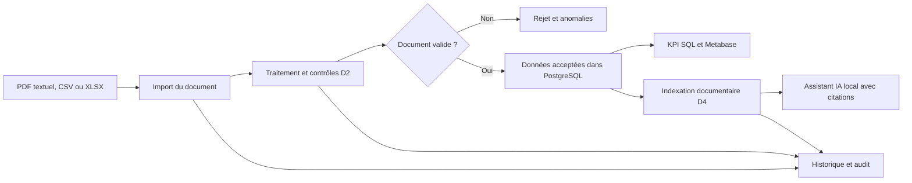

# DocuMind

**Vos documents. Une vision plus claire.**

DocuMind est une **application locale de gestion et d'intelligence documentaire**. Elle permet de recevoir des documents, d'en extraire les informations utiles, de contrôler leur cohérence, de suivre leur provenance, d'analyser les données validées et de poser des questions à un assistant IA qui cite ses sources.

**Version :** V1.0, validée localement le 10 novembre 2026.  
**Environnement principal :** Windows, Docker Desktop et navigateur web.  
**Hébergement :** plateforme complète en local ; démonstration publique limitée à l'API D1 en lecture seule.

> **Pour commencer rapidement :** rendez-vous à [Installation et premier démarrage](#installation-et-premier-démarrage). Si DocuMind est déjà installé, consultez [Relancer l'application](#relancer-lapplication-après-un-redémarrage).

## Sommaire

1. [Pourquoi DocuMind existe](#pourquoi-documind-existe)
2. [Ce que fait l'application](#ce-que-fait-lapplication)
3. [Les cinq espaces](#les-cinq-espaces)
4. [Un exemple concret](#un-exemple-concret)
5. [Installation et premier démarrage](#installation-et-premier-démarrage)
6. [Premiers pas dans l'interface](#premiers-pas-dans-linterface)
7. [Relancer, arrêter et dépanner](#relancer-lapplication-après-un-redémarrage)
8. [Services complémentaires, architecture et tests](#services-complémentaires)
9. [Sécurité, limites et documentation](#sécurité-et-limites)

## Pourquoi DocuMind existe

Imaginez une entreprise qui reçoit chaque jour des factures, des PDF et des tableaux Excel.

Au fil des semaines, les fichiers s'accumulent. Retrouver une information devient laborieux, les contrôles sont souvent manuels, certaines factures sont incohérentes et les chiffres d'un tableau de bord ne sont pas toujours reliés à leur document d'origine.

L'entreprise aimerait pouvoir :

- retrouver rapidement un fichier et les données qu'il contient ;
- détecter les montants incohérents avant de les utiliser ;
- comprendre ses dépenses sans additionner les factures à la main ;
- conserver une trace des opérations et des décisions ;
- interroger ses documents avec une IA **sans recevoir de réponse dépourvue de preuve**.

**DocuMind a été conçu pour répondre à ces besoins.** Ce n'est pas seulement une bibliothèque de fichiers : c'est un parcours de transformation de documents en informations contrôlées, analysables et traçables.

## Ce que fait l'application

Le fonctionnement général tient en cinq verbes :

**Importer → Contrôler → Stocker → Analyser → Interroger**



Quelques règles sont essentielles :

- **Importer ne signifie pas valider.** Un document importé doit ensuite être traité, manuellement ou par le pipeline prévu.
- **Valider ne signifie pas indexer pour l'IA.** L'indexation est une opération distincte, réservée aux documents acceptés.
- **Une facture rejetée n'alimente pas les indicateurs financiers.**
- Les montants proviennent de règles métier et de PostgreSQL, **pas d'une estimation de l'IA**.
- Les réponses de l'assistant sont liées à des passages sources vérifiables. Si la preuve manque, l'assistant peut s'abstenir.

Les documents sont conservés dans l'environnement local. Le projet utilise des exemples **entièrement fictifs** pour les démonstrations et les tests.

## Les cinq espaces

| Espace | Ce que vous voyez | À quoi il sert |
| --- | --- | --- |
| **01 — Vue d'ensemble** | Documents suivis, documents acceptés/rejetés, montants vérifiés, courbe et fournisseurs | Comprendre la situation en un regard et accéder aux autres espaces |
| **02 — Documents** | Catalogue, import, recherche, filtres, états et fiches détaillées | Ajouter des fichiers, examiner les factures et leurs sources, traiter et indexer les documents autorisés |
| **03 — Analyse & KPI** | Factures acceptées, dépenses mensuelles, fournisseurs, anomalies et réconciliation par devise | Analyser les données réellement validées dans PostgreSQL |
| **04 — Assistant IA** | Questions suggérées, champ de conversation, réponses et citations | Retrouver une information dans les documents indexés, ou constater qu'aucune preuve suffisante n'existe |
| **05 — Historique** | Journal chronologique des imports, validations, rejets et indexations | Savoir ce qui s'est passé, quand et sur quel document |

### Comprendre les statuts des documents

| Statut affiché | Signification |
| --- | --- |
| **Reçu** | Fichier enregistré, en attente d'un traitement métier |
| **Accepté** | Contrôles réussis ; les données éligibles peuvent alimenter les analyses |
| **Indexé** | Document accepté également préparé pour la recherche de l'assistant IA |
| **Rejeté** | Contrôle échoué ; le motif est consultable et les valeurs ne contribuent pas aux KPI validés |

Le traitement et l'indexation sont accessibles depuis la **fiche du document**, selon son statut et les permissions de l'opérateur. Les onglets de cette fiche permettent de consulter **Factures**, **Extraits**, **Anomalies** et **Historique**.

## Un exemple concret

Prenons une facture fictive de **120 € TTC** :

1. Dans **Documents**, vous sélectionnez un fichier et cliquez sur **Importer**.
2. Vous ouvrez sa fiche et lancez **Traiter avec D2** lorsque l'action est disponible.
3. DocuMind extrait les champs, conserve la ligne ou la page d'origine et contrôle, notamment, que **HT + TVA = TTC**.
4. Si les contrôles réussissent, les données de la facture peuvent apparaître dans **Analyse & KPI**.
5. Vous pouvez ensuite lancer **Indexer pour l'IA** sur ce document accepté.
6. Dans **Assistant IA**, vous demandez son montant : la réponse doit s'appuyer sur une citation consultable.
7. Dans **Historique**, vous retrouvez les traitements et indexations associés.

**Et si les montants sont incohérents ?** Le document est rejeté, l'anomalie explique l'écart et ses chiffres ne sont pas ajoutés aux indicateurs validés.

Le jeu de démonstration utilisé pendant la recette V1.0 comprend **9 documents (7 acceptés ou indexés, 2 rejetés)** et **15 factures acceptées totalisant 1 344,00 € TTC** dans le corpus EUR. Ces chiffres correspondent aux données synthétiques de référence : ils peuvent évoluer si vous importez d'autres documents.

---

## Installation et premier démarrage

Les instructions ci-dessous décrivent le **parcours Windows validé pour la V1.0**. Le fonctionnement sur macOS ou Linux n'a pas fait l'objet de la même recette PowerShell.

### 1. Prérequis

- **Git**, pour récupérer le dépôt.
- **Docker Desktop**, démarré en mode **conteneurs Linux**.
- **PowerShell** sous Windows.
- Un navigateur moderne.
- Une connexion Internet lors de la première installation, pour télécharger les images Docker, les dépendances et les modèles Ollama.

**Node.js installé sur Windows n'est pas obligatoire** : le service Docker `web` installe et exécute Vite dans son propre conteneur. Le premier démarrage complet avec l'IA peut être gourmand en mémoire ; évitez de lancer simultanément Metabase et Airflow sur une machine limitée.

### 2. Récupérer le code source

Ouvrez PowerShell dans le dossier où vous souhaitez installer l'application :

```powershell
git clone https://github.com/sogoyou8/DocuMind.git
cd DocuMind
```

Vous êtes maintenant à la racine du projet, au même niveau que `compose.yaml`, `frontend/`, `backend/` et `scripts/`.

### 3. Démarrer les services locaux

Vérifiez que Docker Desktop est prêt, puis exécutez :

```powershell
docker compose --profile ai --profile ui up -d --build postgres api ollama rag web
docker compose --profile ai --profile ui ps
```

Cette commande démarre PostgreSQL, l'API Django, Ollama, le service documentaire IA et l'interface React. Les fichiers restent sur votre ordinateur ; elle ne déploie rien sur Render ou Vercel.

### 4. Télécharger les modèles IA locaux (première installation)

```powershell
docker compose --profile ai exec -T ollama ollama pull nomic-embed-text
docker compose --profile ai exec -T ollama ollama pull qwen2.5:1.5b
```

Le premier modèle sert à rechercher des passages documentaires ; le second sert à formuler les réponses. Leurs fichiers sont conservés dans un volume Docker, pour éviter de les retélécharger à chaque redémarrage.

### 5. Initialiser la démonstration, le compte local et vérifier la V1.0

Toujours **à la racine du dépôt** :

```powershell
.\scripts\verify-d51.ps1
```

Cette **recette complète**, plus longue qu'un démarrage quotidien, effectue notamment :

- les contrôles Django, permissions, migrations et API ;
- le chargement/rejeu idempotent du corpus synthétique et la vérification des KPI SQL ;
- l'indexation et la vérification de réponses sourcées avec l'IA locale ;
- la création du compte opérateur privé `documind-local` ;
- les vérifications TypeScript, le build React et les tests Vitest ;
- les scénarios navigateur Playwright et le contrôle de mise en page.

La réussite est indiquée par **`D5 LOCAL OK`** puis **`D5.1 LOCAL OK`**. Les tests produisent des captures dans `frontend/test-results/`.

> La recette peut réinitialiser **le mot de passe du seul compte opérateur de démonstration** à partir du fichier privé local. Elle ne supprime pas les volumes PostgreSQL, ChromaDB ou Ollama. Pour les prochains démarrages, il n'est pas nécessaire de relancer tous les tests.

### 6. Ouvrir DocuMind et se connecter

Ouvrez **http://127.0.0.1:5173**.

- **Identifiant :** `documind-local`
- **Mot de passe :** généré lors de la première recette, conservé dans `data/local/d5-operator.json` (fichier ignoré par Git).

Pour copier le mot de passe **dans le presse-papiers sans l'afficher dans le terminal** :

```powershell
$compte = Get-Content ".\data\local\d5-operator.json" -Raw | ConvertFrom-Json
$compte.password | Set-Clipboard
```

Collez-le ensuite dans le formulaire de connexion avec **Ctrl + V**. Ne partagez jamais ce fichier ni son contenu.

## Premiers pas dans l'interface

Si vous découvrez l'application pour la première fois, suivez ce parcours :

1. **Vue d'ensemble :** observez le nombre de documents, les états et le total validé. Ils proviennent du corpus local, et non de valeurs inventées pour remplir le dashboard.
2. **Documents :** ouvrez un des fichiers de démonstration. Consultez les onglets **Factures**, **Extraits**, **Anomalies** et **Historique**. Comparez un document accepté et un document rejeté.
3. **Premier import :** choisissez un **PDF textuel, CSV ou XLSX** de **5 Mio maximum**. Les scans à OCR, fichiers manuscrits et macros Excel ne sont pas pris en charge par cette V1.0.
4. **Traitement :** dans la fiche du document reçu, lancez **Traiter avec D2**. Contrôlez le résultat et le motif d'un éventuel rejet avant de recommencer.
5. **Analyse & KPI :** voyez les montants et fournisseurs issus des données acceptées. Les calculs financiers sont séparés par devise.
6. **Assistant IA :** sur un document accepté, utilisez **Indexer pour l'IA**, puis posez une question portant sur son contenu. Ouvrez les citations pour vérifier la source.
7. **Historique :** retrouvez les opérations effectuées et leurs horodatages.

**Conseil :** commencez par le corpus fictif déjà présent après la recette, plutôt que d'importer directement des documents personnels.

## Relancer l'application après un redémarrage

Une fois la première installation et la recette terminées, vous n'avez plus besoin de refaire les tests complets à chaque utilisation.

Ouvrez Docker Desktop et un terminal PowerShell **dans `DocuMind`**, puis lancez :

```powershell
docker compose --profile ai --profile ui up -d postgres api ollama rag web
```

Accédez ensuite à **http://127.0.0.1:5173**.

Pour voir les journaux en direct :

```powershell
docker compose --profile ui logs -f web
```

Pour consulter l'état des services :

```powershell
docker compose --profile ai --profile ui ps
```

### Arrêter proprement l'application

```powershell
docker compose --profile ai --profile ui stop web rag ollama api postgres
```

Cette commande **arrête** les conteneurs, mais ne supprime pas les données conservées dans les volumes.

> **Ne jamais exécuter `docker compose down -v`** pour arrêter DocuMind : l'option `-v` supprime les volumes associés, dont les données locales PostgreSQL et les modèles/index conservés.

### Problèmes courants

| Symptôme | Explication et action |
| --- | --- |
| **`vite` n'est pas reconnu sur Windows** | Ne lancez pas `npm run dev` sur l'hôte sans installer les dépendances. Utilisez le conteneur `web` avec `docker compose --profile ui up -d web`. |
| **La page `127.0.0.1:5173` ne s'ouvre pas** | Vérifiez Docker Desktop, puis `docker compose --profile ui logs --tail=100 web` et `docker compose --profile ai --profile ui ps`. |
| **Connexion impossible ou mot de passe absent** | Le fichier privé est créé par `verify-d51.ps1` / `verify-d5.ps1`. Relancez la recette de provisionnement depuis la racine si elle n'a jamais réussi. |
| **L'IA n'est pas prête** | Vérifiez `docker compose --profile ai logs --tail=100 ollama rag` et la présence des deux modèles Ollama. |
| **Le document est importé mais absent des KPI** | Un import n'est pas une validation. Ouvrez sa fiche, traitez-le avec D2, puis vérifiez son état et ses anomalies. |
| **L'assistant ne trouve pas la réponse** | Vérifiez que le document a été accepté **et indexé** ; une abstention peut aussi être normale si aucune preuve pertinente n'existe. |
| **Metabase est vide au premier lancement** | Son tableau de bord doit être configuré avec la recette analytique `.\scripts\verify-d3.ps1`, pas seulement avec `docker compose up`. |
| **La machine ralentit** | Arrêtez les services optionnels non utilisés, notamment Airflow et Metabase ; l'IA locale consomme aussi des ressources. |

## Services complémentaires

L'interface React fournit les cinq pages principales sans nécessiter de garder Airflow et Metabase ouverts en permanence.

| Service | Adresse locale | Utilité |
| --- | --- | --- |
| **Interface React** | http://127.0.0.1:5173 | Application utilisée au quotidien |
| **API Django principale** | http://127.0.0.1:8000/api/v1/health/ | Santé de l'API et backend |
| **Documentation OpenAPI** | http://127.0.0.1:8000/api/v1/docs/ | Routes et contrats HTTP |
| **Django avec RAG** | http://127.0.0.1:8001/api/v1/health/ | API locale utilisée par l'interface pour l'assistant |
| **PostgreSQL** | `127.0.0.1:15434` | Base de données locale ; pas un site web |
| **Ollama** | `127.0.0.1:11435` | Modèles IA locaux |
| **Metabase** | http://127.0.0.1:3033 | BI avancée, profil Docker `analytics` |
| **Airflow** | http://127.0.0.1:8088 | Orchestration, profil Docker `pipeline` |

### Metabase — analyse BI avancée

Metabase n'est pas la page **Analyse & KPI** de React : c'est un outil complémentaire qui lit des vues PostgreSQL gouvernées.

Pour la **première configuration** (création du lecteur SQL, des questions et du dashboard) :

```powershell
.\scripts\verify-d3.ps1
```

Pour le **relancer ensuite** :

```powershell
docker compose --profile analytics up -d metabase
```

La recette D3 prépare **12 questions SQL** sur le corpus de démonstration. Sur une machine avec peu de mémoire, arrêtez les services lourds inutilisés avant de démarrer Metabase.

### Airflow — planification du traitement

```powershell
docker compose --profile pipeline up -d airflow
```

Airflow peut orchestrer les traitements via un DAG local. Il n'est **pas nécessaire** pour lancer un traitement directement depuis la fiche d'un document. Pour vérifier le pipeline et les reprises de traitement avec la recette dédiée :

```powershell
.\scripts\verify-d2.ps1
```

### Architecture technique

| Couche | Technologies | Responsabilités |
| --- | --- | --- |
| Interface | React 19, TypeScript, Vite | Navigation, fichiers, analyses et assistant |
| API et sécurité | Python, Django REST Framework, session/CSRF | Autorisations, imports, traitements, contrats HTTP et audit |
| Extraction et qualité | Python, Pandas, openpyxl, pypdf | Lecture, normalisation, contrôles et provenance |
| Données | PostgreSQL 16 | Documents, factures validées, états, anomalies, événements et vues SQL |
| Orchestration | Apache Airflow | Planification, exécution, reprise et journal des traitements |
| BI | Metabase | Tableaux de bord sur vues SQL en lecture seule |
| IA locale | Ollama, ChromaDB, LangGraph | Recherche de passages, génération contrôlée, citations et abstention |
| Exécution et QA | Docker Compose, Vitest, Playwright, tests Django | Reproductibilité, contrôles métier, API et interface |

### Organisation du dépôt

```text
DocuMind/
├── backend/       # Django, modèles, API, traitement documentaire, SQL, RAG
├── frontend/      # React / TypeScript et tests d'interface
├── airflow/       # DAG de traitement local
├── scripts/       # Initialisation, recettes et provisionnement
├── docs/          # Sujet, architecture, preuves et décisions
├── compose.yaml   # Services et profils Docker
├── render.yaml    # Démonstration publique limitée de l'API D1
└── data/local/    # Secrets et état locaux générés (ignorés par Git)
```

## Vérifier la V1.0

La commande de référence pour la recette complète est :

```powershell
.\scripts\verify-d51.ps1
```

**Dernière validation documentée, 10 novembre 2026 :** 58/58 tests Django, 13/13 tests Vitest, 4/4 scénarios Playwright Chromium, vérification SQL D3, RAG D4 réel et contrôles du rendu compact. Ce sont les résultats de la **recette historique de la V1.0**, pas une nouvelle exécution automatiquement réalisée lors de la lecture du README.

Pour des vérifications ciblées après installation :

```powershell
docker compose --profile ai exec -T rag python manage.py check
docker compose --profile ui exec -T web npm run typecheck
docker compose --profile ui exec -T web npm test
docker compose --profile ui exec -T web npm run build
```

Les captures navigateur de la recette restent dans `frontend/test-results/` et les rapports Playwright dans `frontend/playwright-report/` ; ce sont des fichiers locaux, pas des captures automatiquement publiées sur Internet.

## Sécurité et limites

DocuMind V1.0 est une **application locale**, conçue pour apprendre, démontrer et contrôler un flux documentaire avec des données autorisées.

- **Données :** le jeu fourni est fictif. N'importez pas de documents réels sensibles sans politique d'accès, de rétention et de protection adaptée.
- **Fichiers :** PDF textuels, CSV et XLSX structurés ; pas d'OCR des scans ni de reconnaissance manuscrite en V1.0.
- **Rôles :** l'import, les traitements et l'indexation sont soumis aux permissions de l'opérateur.
- **Analyses :** seules les données validées alimentent les indicateurs ; aucune addition implicite entre devises.
- **IA :** aucune API LLM payante ou externe n'est nécessaire à l'instance complète. Un modèle local peut se tromper : vérifiez toujours les citations et les extraits.
- **Stockage :** les volumes Docker et `data/local/` restent privés ; ne publiez ni secrets, ni factures, ni sauvegardes.
- **Publication :** le service [Render D1](https://documind-d1-api-htpg.onrender.com) est une démonstration **distincte et limitée** de l'API, en lecture seule sur métadonnées synthétiques. Il **n'héberge pas** le cockpit complet, PostgreSQL local, Airflow, Metabase ou Ollama.
- **Abyss Showcase :** [fiche de présentation DocuMind](https://abyss-public-showcase.vercel.app/projects/documind). Cette fiche ne doit pas être confondue avec un hébergement public de l'application complète.

La version complète V1.0 reste figée : la présente documentation n'annonce aucun nouveau déploiement ni changement fonctionnel.

## Pour aller plus loin

- [Sujet du projet — Markdown](docs/Sujet-du-projet.md) et [PDF](docs/Sujet-du-projet.pdf) : contexte, mission, exigences et critères de validation.
- [Architecture](docs/ARCHITECTURE.md) et [diagrammes UML](docs/UML.md) : composants, données et flux.
- [État D1](docs/ETAT-D1.md) : API, permissions et démonstration Render.
- [État D2](docs/ETAT-D2.md) : extraction, contrôles, rejet et Airflow.
- [État D3](docs/ETAT-D3.md) : vues SQL, réconciliation et Metabase.
- [État D4](docs/ETAT-D4.md) : assistant IA local, index et citations.
- [État D5](docs/ETAT-D5.md) et [plan D5.1](docs/PLAN-D51.md) : interface React, validation de bout en bout et finition UX/UI.

**En une phrase :** DocuMind vous aide à passer **d'un fichier reçu à une information vérifiée, compréhensible et reliée à sa source**.
